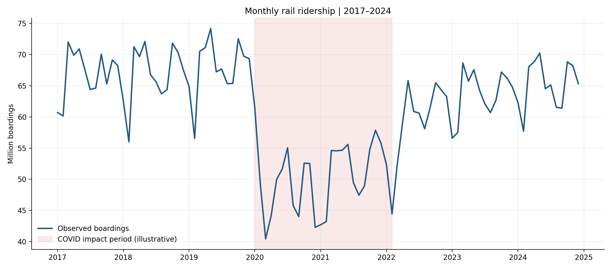
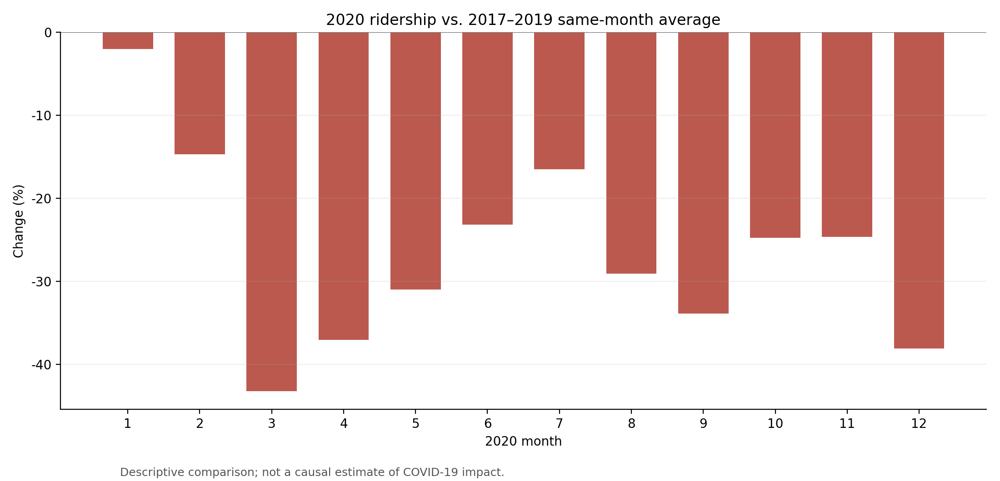
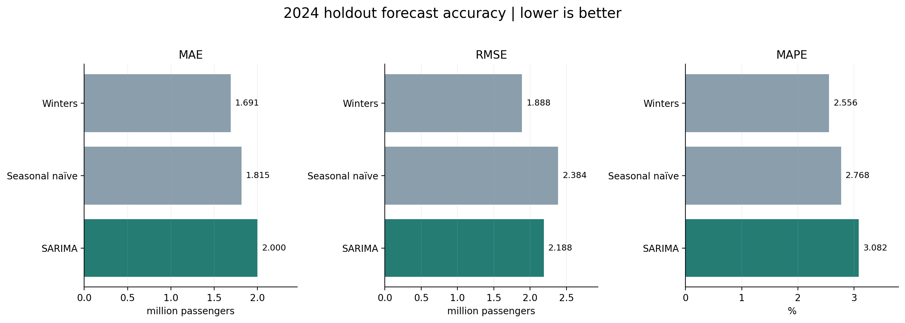
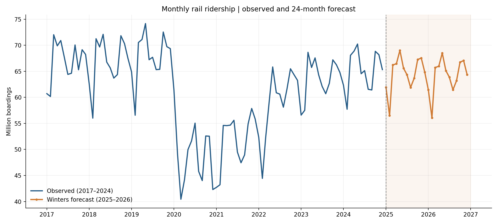

# 국내 철도 승차 수요 변화와 예측 (2017–2026)

한국철도공사(KORAIL) 월별 승차자 수 공개 자료를 이용해 **2017–2024년 수요 변화**를 분석하고, 2024년 홀드아웃 검증을 통해 예측 모형을 비교한 데이터 분석 포트폴리오입니다. **2025–2026년 값은 관측값이 아닌 2024년 12월 기준 사전 예측값**입니다.

## 프로젝트 개요
- 분석 데이터: 2017년 1월~2024년 12월, 월별 96개 관측치
- 분석 도구: SAS (PROC ARIMA, PROC ESM), Python (pandas, matplotlib)
- 검증 설계: 2017–2023년 학습(84개월), 2024년 테스트(12개월)
- 후보 모형: SARIMA(1,1,1)(0,1,1)[12], Winters 지수평활법, 계절 나이브
- 최종 모형: **Winters**, 2024년 테스트 MAPE **2.556%**

## 2024년 홀드아웃 평가
| 모형 | MAE (명) | RMSE (명) | MAPE |
|---|---:|---:|---:|
| Winters | 1,691,282 | 1,888,397 | **2.556%** |
| 계절 나이브 | 1,815,355 | 2,383,976 | 2.768% |
| SARIMA | 2,000,076 | 2,187,814 | 3.082% |

단일 12개월 검증 구간의 결과이므로 미래 예측 정확도를 보장하지 않습니다.

## 주요 시각화
**1. 2017–2024년 월별 승차자 수 추이**


**2. 2020년 월별 승차자 수 변화: 2017–2019년 동월 평균 대비**


이 비교는 기술통계이며 코로나19만의 인과적 영향을 식별한 결과는 아닙니다.

**3. 2024년 예측 성능 비교**


**4. 2025–2026년 Winters 예측**


## 결과 해석
2025년 월별 예측치 합계는 약 **7.75억 명**, 2026년은 약 **7.70억 명**입니다. 두 수치는 월별 예측값을 합산한 전망치이며 실제 이용 실적이 아닙니다. 외생 변수, 구조적 변화, 장기 예측 불확실성을 충분히 반영하지 못한다는 한계가 있습니다.

## 폴더 구조
```text
rail_ridership_github/
├── README.md
├── requirements.txt
├── data/
│   ├── rail_original.xlsx
│   ├── rail_actual_2017_2024.csv
│   └── winters_forecast_2025_2026.csv
├── scripts/
│   ├── model_validation.sas
│   ├── final_winters_forecast.sas
│   └── rail_portfolio_charts.py
├── figures/
│   └── 4 PNG charts
└── portfolio/
    └── rail_portfolio.pdf
```

## 실행 방법
Python 3.10 이상 권장:
```bash
pip install -r requirements.txt
python scripts/rail_portfolio_charts.py
```
실행 시 `data/`의 CSV와 `figures/`의 PNG를 다시 생성합니다. SAS 파일은 SAS Studio에서 실행하며, 각 스크립트의 `%let source_file=`을 본인 SAS 서버의 Excel 파일 경로로 변경해야 합니다. SAS/ETS 기능이 필요할 수 있습니다.

## 데이터 출처 및 주의
- 출처: 한국철도공사(KORAIL) 공개 월별 철도 승차 자료 (원본 Excel은 프로젝트에 사용한 사본)
- 예측값 CSV: SAS `WORK.FINAL_FORECAST` 결과 화면의 월별 표시값을 전사한 자료. SAS 내부 소수점 정밀도와 합계에서 미세한 차이가 날 수 있습니다.
- 개인·공동 작업의 기여 범위는 이력서 및 면접에서 실제 수행 내용에 맞게 설명해야 합니다.
